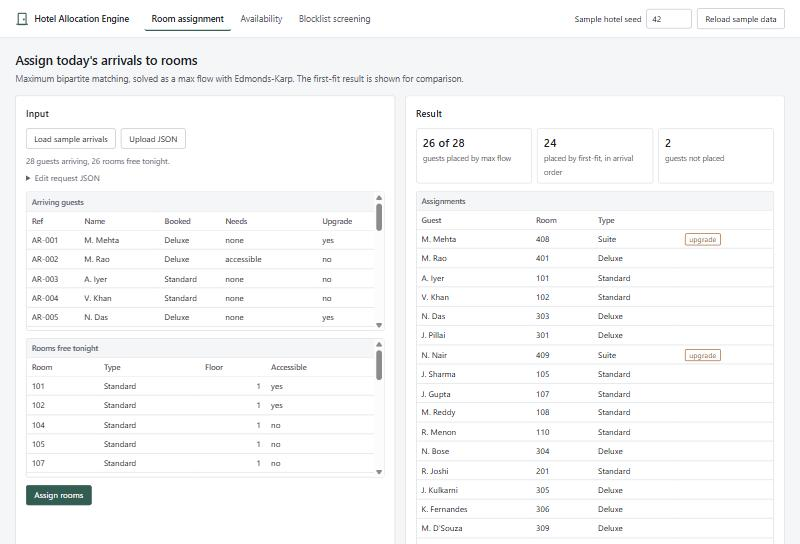
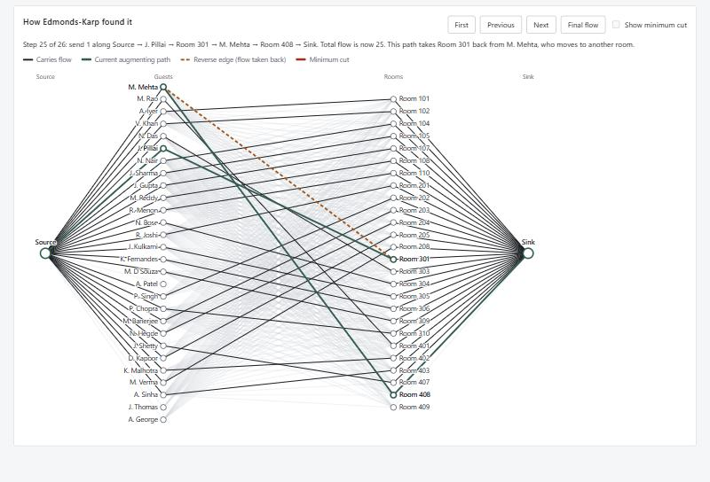
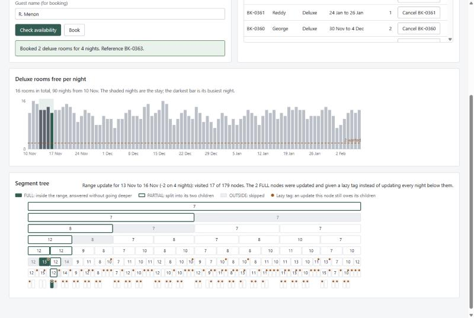
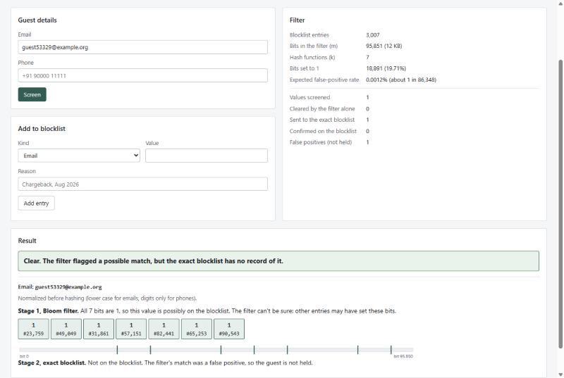

# Hotel Allocation Engine

A front-desk tool for a 40-room city hotel, built for the CIA 3 Advanced Algorithm project
(Semester V, B.Tech CS AI & ML, 2026-27). Three everyday decisions are each driven by an algorithm
written from scratch in Java:

| Decision | Algorithm | Syllabus unit | Baseline it is compared with |
|---|---|---|---|
| Which arriving guest gets which room tonight | Maximum bipartite matching as max flow (Edmonds-Karp), with the minimum cut as the bottleneck | Unit 5 | First-fit in arrival order |
| Can a stay of N nights be booked, and book it | Segment tree with lazy propagation (range minimum, range add) | Unit 3 | Scanning every night |
| Is a new booking's email or phone on the fraud blocklist | Bloom filter, then an exact check on "possibly listed" (CO5) | Unit 6 | HashSet |

The frontend draws each algorithm's trace step by step. All results are computed by the Java backend;
the browser only displays what the API returns.



## Contents

- [Requirements](#requirements)
- [Build, test and run](#build-test-and-run)
- [Using the app](#using-the-app)
- [API](#api)
- [Sample data](#sample-data)
- [Tests and benchmarks](#tests-and-benchmarks)
- [Project structure](#project-structure)
- [Limitations](#limitations)
- [Team and contributions](#team-and-contributions)

## Requirements

- **Java 21 or newer** (JDK 21 LTS recommended). Check with `java -version`. If several JDKs are
  installed, set `JAVA_HOME` to a Java 21+ JDK.
- **No Maven install needed.** The Maven Wrapper (`mvnw` / `mvnw.cmd`) downloads the right version on first
  run. The first build also downloads dependencies, so it needs internet access and takes a few minutes.
- **The project folder path must use only English (ASCII) characters**, for example `C:\dev\hotel-allocation-engine`.
  On Windows with a non-Japanese system code page, a path containing characters such as `ドキュメント`
  is passed to the forked Java process as `??????` and the main class is not found.
- No database. All data is held in memory and the sample hotel is loaded at startup.

## Build, test and run

Windows (PowerShell), from the project folder:

```powershell
.\mvnw.cmd clean test
```

```powershell
.\mvnw.cmd spring-boot:run
```

macOS / Linux:

```shell
./mvnw clean test
./mvnw spring-boot:run
```

Open **http://localhost:8080**. Stop the server with Ctrl + C.

If port 8080 is taken, run on another port:

```powershell
.\mvnw.cmd spring-boot:run "-Dspring-boot.run.arguments=--server.port=8081"
```

To build a single runnable jar:

```powershell
.\mvnw.cmd clean package
java -jar target\hotel-allocation-engine-0.0.1-SNAPSHOT.jar
```

Always use `clean` after deleting or renaming Java classes, otherwise old compiled classes stay in `target/`.

### Settings

`src/main/resources/application.properties`:

| Property | Default | Meaning |
|---|---|---|
| `hotel.sample.enabled` | `true` | Load the sample hotel at startup |
| `hotel.sample.seed` | `42` | Seed for the generated hotel; the same seed gives the same arrivals, rooms and blocklist |

No secrets or environment variables are needed.

## Using the app

### Room assignment

Load the sample arrivals (or upload a JSON file shaped like `samples/assignment-request.json`) and press
**Assign rooms**. The result shows how many guests max flow placed against first-fit, a plain reason for
each guest who wasn't placed, and the bottleneck rooms from the minimum cut. Below it, step through every
augmenting path. Reverse edges (a guest being moved to another room) are drawn as amber dashes, and
**Final flow > Show minimum cut** marks the cut whose capacity equals the max flow.



### Availability

Pick a room type, dates and number of rooms, then **Check availability** or **Book**. The calendar shows
free rooms for 90 nights with the stay shaded. The segment tree is drawn under it, aligned night for night,
and colours each node by what the last operation did: FULL (answered without going deeper), PARTIAL (split)
or OUTSIDE (skipped). An amber dot marks a pending lazy tag.



### Blocklist screening

Enter an email and/or phone number and press **Screen**. Stage 1 shows the 7 bits each value hashes to;
any 0 bit means "definitely not listed". If all bits are 1, Stage 2 checks the exact blocklist, which has the
final say. With the default sample data (seed 42), `guest53329@example.org` is a real false positive:
all 7 bits are set but the email is not listed, so the guest is cleared.



## API

All endpoints take and return JSON. Errors always have the same shape and use 400 for bad input:

```json
{ "status": 400, "error": "Bad Request", "message": "Some fields need fixing.",
  "fields": [ { "field": "guests[0].name", "problem": "must not be blank" } ] }
```

| Method | Path | Purpose |
|---|---|---|
| POST | `/api/assignments` | Assign guests to rooms. Body: `{ "guests": [...], "rooms": [...] }` (up to 2,000 each) |
| POST | `/api/availability/check` | Check a stay. Body: `{ "roomType", "checkIn", "checkOut", "rooms" }` |
| POST | `/api/availability/bookings` | Book a stay. Same body plus `"guestName"` |
| GET | `/api/availability/bookings` | List bookings |
| DELETE | `/api/availability/bookings/{id}` | Cancel a booking |
| GET | `/api/availability/calendar?type=DELUXE` | Free rooms per night and all tree nodes for one room type |
| POST | `/api/screening/check` | Screen `{ "email", "phone" }` (at least one) |
| POST | `/api/screening/blocklist` | Add `{ "kind": "EMAIL" or "PHONE", "value", "reason" }` |
| GET | `/api/screening/stats` | Filter size, hash count, false-positive rate and counters |
| GET | `/api/sample/arrivals` | Today's sample arrivals and free rooms |
| POST | `/api/sample/reset?seed=42` | Reload the sample hotel, discarding changes |

Room types are `STANDARD`, `DELUXE` and `SUITE`. Dates are `yyyy-mm-dd`. A stay uses the nights from
check-in up to the night before check-out.

Examples (PowerShell, from the project folder, server on 8080):

```powershell
Invoke-RestMethod -Method Post -Uri http://localhost:8080/api/assignments -ContentType "application/json" -InFile samples\assignment-request.json | ConvertTo-Json -Depth 6
```

```powershell
Invoke-RestMethod -Method Post -Uri http://localhost:8080/api/availability/bookings -ContentType "application/json" -InFile samples\booking-request.json | ConvertTo-Json -Depth 6
```

```powershell
Invoke-RestMethod -Method Post -Uri http://localhost:8080/api/screening/check -ContentType "application/json" -InFile samples\screening-request.json | ConvertTo-Json -Depth 6
```

The same with curl (macOS / Linux):

```shell
curl -s -X POST localhost:8080/api/assignments -H "Content-Type: application/json" -d @samples/assignment-request.json
```

Note: `samples/booking-request.json` uses fixed dates. The calendar starts on the day the server starts and
covers 90 nights, so change the dates if they fall outside that window.

## Sample data

All data is synthetic and generated by `SampleHotel` from a seed, so it is reproducible:

- **Rooms:** 40 rooms on 4 floors (20 standard, 16 deluxe, 4 suites). Only 7 are wheelchair accessible.
- **Tonight:** 14 rooms are held by guests staying on, leaving 26 free for 28 arrivals. About 15% of
  arrivals need an accessible room, 12% have a highest floor, and 35% accept an upgrade.
- **Calendar:** 450 future booking requests over 90 nights, busier at weekends; those that don't fit are
  turned away, as a real hotel would.
- **Blocklist:** 7 readable entries plus 3,000 generated ones. Every email uses the reserved
  `example.com`, `example.net` or `example.org` domains, so none belongs to a real person.

Arrivals, free rooms and the blocklist depend only on the seed. The calendar bookings also depend on the
start date (weekends are busier), so they differ from day to day.

## Tests and benchmarks

```powershell
.\mvnw.cmd test
```

40 JUnit tests, at least 5 per core algorithm, each set including edge cases and invalid input:

| Test class | What it checks |
|---|---|
| `BloomFilterTest` | Sizing formulas, no false negatives, measured false-positive rate within 25% of theory over 200,000 trials, empty and one-item filters, invalid sizes |
| `EdmondsKarpTest` | Textbook network (max flow 23 = min cut), reverse edges, unreachable sink, zero and parallel edges, agreement with brute-force matching on 500 random graphs |
| `AvailabilitySegmentTreeTest` | Range minimum example, one-night calendar, refused bookings change nothing, book then cancel restores, agreement with a plain array over 100,000 random operations, at most 4 nodes visited per level |
| `RoomAssignmentServiceTest` | Beats first-fit on a known case, reasons for unplaced guests, upgrades, validity on 20 generated hotels |
| `AvailabilityServiceTest` | Back-to-back stays, overlaps, calendar edges, cancellation, invalid dates |
| `ScreeningServiceTest` | Normalisation, false positives never block a guest, duplicates, invalid input |

Benchmarks (about 15 seconds to a few minutes, depending on the machine):

```powershell
.\mvnw.cmd test "-Dtest=AlgorithmBenchmark"
```

Each size uses fixed seeds, 2 warm-up runs and the median of 5 timed runs. Results are written to
`target/benchmarks/*.csv`; a saved run is in `docs/benchmarks/results/`. One run on the development laptop:

| Segment tree, 20,000 operations | 1,000 nights | 10,000 nights | 100,000 nights |
|---|---|---|---|
| Segment tree | 4.9 ms | 7.2 ms | 14.4 ms |
| Scanning every night | 5.0 ms | 46.6 ms | 496 ms |

| Room assignment, rooms = 90% of guests | 100 guests | 1,000 guests | 5,000 guests |
|---|---|---|---|
| Placed by max flow / first-fit | 79 / 67 | 743 / 643 | 3,730 / 3,242 |
| Max flow time | 0.7 ms | 10.9 ms | 672 ms |

| Bloom filter, p = 1% | 10,000 entries | 100,000 entries | 1,000,000 entries |
|---|---|---|---|
| Memory: filter / HashSet | 12 KB / 550 KB | 117 KB / 5.0 MB | 1.2 MB / 37.6 MB |
| False-positive rate: expected / measured | 1.00% / 0.98% | 1.00% / 0.97% | 1.00% / 1.01% |

Timings vary noticeably between runs on a laptop; close other programs before taking numbers for a report.
`docs/benchmarks/optimisation-comparison.md` describes the optimisation pass and a fair before/after comparison.

## Project structure

```
src/main/java/com/hotel/engine/
  algorithm/          the assessed algorithms, no Spring dependencies
    bloom/            BloomFilter, BloomTrace
    flow/             FlowNetwork, EdmondsKarp, AugmentingStep, MaxFlowResult
    segtree/          AvailabilitySegmentTree, NodeVisit, SegmentTreeTrace
    baseline/         FirstFitAssigner
  domain/             Room, Guest, RoomType, InvalidInputException
  service/            RoomAssignmentService, AvailabilityService, ScreeningService
  api/                REST controllers and ApiExceptionHandler
  sample/             SampleHotel generator and SampleDataService (startup loader)
src/main/resources/static/   frontend: index.html, css/, js/ (plain JavaScript modules, no build step)
src/test/java/...            JUnit tests and AlgorithmBenchmark
samples/                     example request bodies
docs/                        benchmark results, screenshots, report notes, demo script
```

The layers only call downward: controllers validate input and call services; services build the inputs,
call the algorithms and explain the results; the algorithms know nothing about hotels or HTTP.

## Limitations

- **Room assignment is all-or-nothing per guest.** It maximises the number of guests placed, not their
  preferences (for example, a preferred floor beyond the hard limit). Weighted preferences would need
  min-cost flow.
- **Edmonds-Karp is O(V E^2).** It handles a few thousand guests in under a second, but Hopcroft-Karp
  (O(E sqrt(V))) would scale better for very large matchings.
- **The minimum cut is not unique.** When the hotel is full, every room is on the cut that is reported, so
  the app says the hotel is full instead of listing rooms.
- **Bloom filter entries can't be removed.** Removing a blocklist entry would need a rebuild or a counting
  Bloom filter. Past the planned capacity the false-positive rate rises; the stats panel warns about this.
- **The exact blocklist is an in-memory map** standing in for a database table. The filter's real saving is
  avoiding that lookup for about 99% of guests, which a remote database would make much larger.
- **Everything is in memory.** Restarting the server reloads the sample hotel and discards bookings.
- **Concurrency is simple:** each service method is `synchronized`. That is enough for one front desk, not
  for high request volumes.

## Team and contributions

| Name | Student ID | Contribution |
|---|---|---|
| | | |
| | | |
| | | |

The project skeleton was generated with Spring Initializr (Spring Boot 4.1.2). The algorithms, services,
tests and frontend were written for this project; Spring provides only the web and validation infrastructure.
