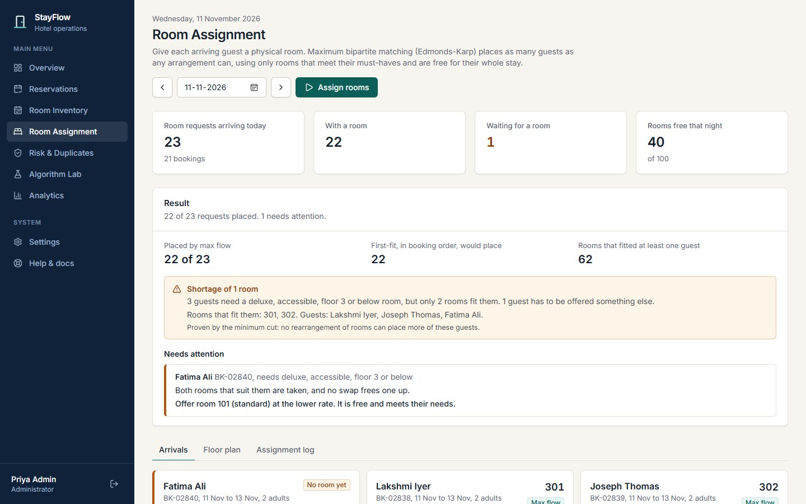
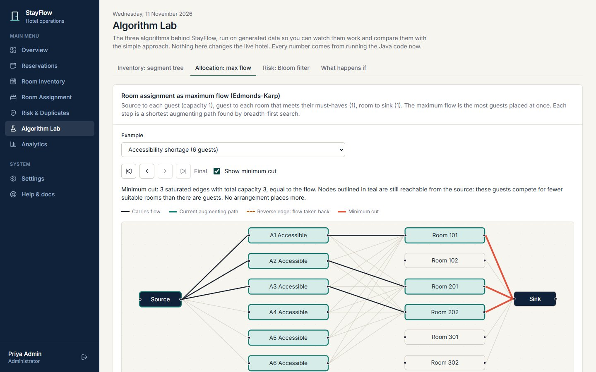

# StayFlow

Hotel inventory and room allocation for a 100-room hotel, built for the CIA 3 Advanced Algorithm project
(Semester V, B.Tech CS AI & ML, 2026-27). Front-desk staff take bookings, check guests in and out and assign
rooms; managers handle maintenance, the watchlist and held bookings. Three of those decisions are made by
algorithms written from scratch in Java:

| Decision | Algorithm | Syllabus unit | Compared with |
|---|---|---|---|
| Can this stay be booked, and book it | Segment tree with lazy propagation (range minimum, range add) per room type | Unit 3 | Scanning every night of the stay |
| Which arriving guest gets which room | Maximum bipartite matching as max flow (Edmonds-Karp); the minimum cut explains any shortage | Unit 5 | First-fit in booking order |
| Is this guest's email or phone on the watchlist | Bloom filter, then an exact database lookup for every "possibly" (CO5) | Unit 6 | HashSet |

The Java backend makes every decision. The React frontend only displays what the API returns, including
the Algorithm Lab, which runs the same Java code on generated data and shows each step.



## Contents

- [Requirements](#requirements)
- [Run it](#run-it)
- [Demo accounts](#demo-accounts)
- [Pages](#pages)
- [How the algorithms are used](#how-the-algorithms-are-used)
- [API](#api)
- [Demo data](#demo-data)
- [Tests and benchmarks](#tests-and-benchmarks)
- [Project structure](#project-structure)
- [Design decisions and limitations](#design-decisions-and-limitations)
- [Team and contributions](#team-and-contributions)

## Requirements

- **Docker Desktop**, running. PostgreSQL 17 runs in a container from `compose.yaml`.
- **Java 21 or newer** (JDK). Check with `java -version`. Not needed if you only use the full Docker setup.
- **No Maven or Node install needed.** The Maven Wrapper downloads Maven, and the build downloads its own
  Node into `target/node` to build the frontend. The first build needs internet access and takes a few minutes.
- **The project folder path must use only English (ASCII) characters**, for example
  `C:\dev\hotel-allocation-engine`. On Windows, a path with characters such as `ドキュメント` reaches the
  forked Java process as `??????` and the main class is not found.

## Run it

### Option 1: everything in Docker

```bash
docker compose --profile app up --build
```

This builds one image (frontend, then backend, then a small Java runtime) and starts it with the database.
Open **http://localhost:8080** once the log shows `Started HotelAllocationEngineApplication`. On the
first start the app then fills the empty database with the demo hotel; wait for `Demo hotel loaded`
(about 10 seconds more). Stop with Ctrl + C; the
data stays in the `stayflow-data` volume.

### Option 2: run from source

Windows (PowerShell), from the project folder:

```powershell
.\mvnw.cmd spring-boot:run
```

macOS / Linux:

```bash
./mvnw spring-boot:run
```

Spring Boot starts the database container from `compose.yaml` by itself (Docker Desktop must be running),
builds the frontend into `target/classes/static` and serves everything on **http://localhost:8080**.
The database container keeps running after the app stops, so the next start is quick.

If port 8080 is taken:

```powershell
.\mvnw.cmd spring-boot:run "-Dspring-boot.run.arguments=--server.port=8081"
```

### Frontend development

For instant reloads while editing the frontend, run the API without rebuilding the frontend, then the Vite
dev server, which forwards `/api` to the API:

```powershell
.\mvnw.cmd spring-boot:run "-Dskip.npm" "-Dskip.installnodenpm"
```

```powershell
cd frontend
npm install
npm run dev
```

Open **http://localhost:5173**. If the API runs on another port, set `STAYFLOW_API` first, for example
`$env:STAYFLOW_API = "http://localhost:8085"`.

### Browsing the database (pgAdmin)

pgAdmin runs next to the database and starts with it. Open **http://localhost:5050** (no pgAdmin login),
expand **Servers, StayFlow** and enter the password `stayflow`; tick **Save Password** to skip it next time.
Tables are under **Databases, stayflow, Schemas, public, Tables**; right-click one and choose
**View/Edit Data** to see its rows, or use **Tools, Query Tool** for SQL.

To start it by hand: `docker compose up -d pgadmin`. Other tools connect to `localhost:5432`, database,
user and password all `stayflow`.

### Starting over

**Settings, Demo data, Reset** regenerates the hotel from a seed. To delete the database completely:

```bash
docker compose --profile app down -v
```

## Demo accounts

| Username | Password | Role |
|---|---|---|
| `admin` | `admin-demo-2026` | Administrator: everything, including staff accounts, filter size and demo reset |
| `manager` | `manager-demo-2026` | Manager: everything except Settings |
| `frontdesk` | `frontdesk-demo-2026` | Front desk: reservations, check-in and check-out, screening, inventory checks, room assignment |

These accounts are created on first start from `application.properties` and are for local use only.
Change or remove them before running StayFlow anywhere shared.

## Pages

| Page | What it does |
|---|---|
| **Overview** | Today's figures, occupancy for the last 30 and next 30 nights, what needs attention (nearly full nights, held bookings, unassigned arrivals), today's activity |
| **Reservations** | Search and filter all bookings; new booking (screen, check, book in one step); edit dates or type; cancel, approve, check in and out; CSV import and export |
| **Room inventory** | Heatmap of free rooms per type and night; check a stay; block rooms for maintenance |
| **Room assignment** | Run the assignment for a date, see each guest's must-haves and room, compare with first-fit, read the shortage explanation, move a guest by hand |
| **Risk and duplicates** | The watchlist, a two-stage checker that shows the filter's bits and the exact lookup, filter statistics, and a button that finds a real false positive |
| **Algorithm Lab** | Step through each algorithm on data you control, run benchmarks against the baselines, and four "what happens if" scenarios |
| **Analytics** | Occupancy, arrivals and departures, demand by room type, assignment and screening results, the audit log |
| **Settings** | Staff accounts, Bloom filter size, room CSV import, demo data reset (administrators only) |
| **Help** | How each page and algorithm works |



More screenshots in [`docs/screenshots/`](docs/screenshots): overview, reservations, inventory heatmap,
the two-stage watchlist check with a real false positive, and the segment tree and Bloom filter labs.

## How the algorithms are used

**Inventory (segment tree).** Each room type has two segment trees over the next 400 nights: one counting
all free rooms and one counting free accessible rooms. A stay fits if the minimum over its nights is at
least the number of rooms wanted (range-minimum query); booking subtracts from the whole range at once
with lazy propagation, and cancelling adds it back. Both take O(log n) time, about 9 tree levels, whatever
the stay length. A booking that needs an accessible room must fit both trees. Maintenance blocks are range
updates too. The trees are rebuilt from the database at startup and after any failed transaction.

**Assignment (Edmonds-Karp).** For a date, every arriving room request becomes a guest node and every room
that meets its must-haves (type, or better if the guest accepts an upgrade; accessible if needed; at or below
the highest floor) and is free for the **whole stay** becomes an edge. Source to guest, guest to room and
room to sink all have capacity 1, so the maximum flow is the largest number of guests placed at once.
Breadth-first search finds the shortest augmenting path each time, and reverse edges let it move a guest
placed earlier. When not everyone fits, the nodes still reachable from the source after the last search
(the source side of the minimum cut) form the group that is short, which the app reports in plain words,
for example "3 guests need a deluxe, accessible, floor 3 or below room, but only 2 rooms fit them".
Preferred floor only breaks ties. If a room goes out of service, its guests are reassigned automatically.

**Screening (Bloom filter).** The watchlist table is loaded into a Bloom filter sized from an expected
number of entries n and a target false-positive rate p: m = -n ln p / (ln 2)^2 bits and k = (m / n) ln 2
hash functions (double hashing: position i = h1 + i * h2 mod m, from two 64-bit hashes of the value). "Definitely not listed" clears the guest without a
database query. "Possibly listed" goes to an exact lookup, so a false positive never holds a booking.
Removing an entry rebuilds the filter. Duplicate bookings are **not** detected with the filter: they use
exact database rules and an idempotency key, because a false positive there would turn away a real guest.

## API

The API uses the same session login as the app. Interactive documentation is at
**http://localhost:8080/swagger-ui.html**: sign in to the app first in the same browser, then use
"Try it out" (Swagger sends the CSRF token for you).

Main endpoints:

| Method | Path | Purpose |
|---|---|---|
| POST | `/api/auth/login` | `{ "username", "password" }`; `GET /api/auth/me` returns the signed-in user |
| GET / POST | `/api/reservations` | Search (`q`, `status`, `type`, `from`, `to`, `page`, `size`) / create: screen, check and book. Optional `Idempotency-Key` header |
| PATCH | `/api/reservations/{ref}` | Change dates, type or needs (released and re-reserved atomically) |
| POST | `/api/reservations/{ref}/cancel`, `/approve`, `/check-in`, `/check-out` | Lifecycle actions |
| POST | `/api/inventory/check` | Does a stay fit, and if not, which night is the bottleneck and what fits instead |
| GET | `/api/inventory/heatmap?from=&days=` | Free, booked and blocked rooms per type and night |
| POST / DELETE | `/api/maintenance`, `/api/maintenance/{id}` | Block or release rooms (manager) |
| GET / POST | `/api/assignments/board?date=`, `/api/assignments/run?date=` | Requests and rooms for a date / run Edmonds-Karp and save |
| PUT / DELETE | `/api/assignments/requests/{id}/room` | Move a guest by hand / remove the room |
| POST | `/api/screening/check` | Two-stage watchlist check of `{ "email", "phone" }` |
| GET / POST / DELETE | `/api/watchlist` | List, add (`{ "kind": "EMAIL" or "PHONE", "value", "reason" }`), remove (manager) |
| GET | `/api/overview`, `/api/analytics`, `/api/audit` | Dashboard figures and the audit log |
| GET / POST | `/api/lab/...` | Algorithm Lab demos, benchmarks and scenarios |
| * | `/api/admin/...` | Users, Bloom configuration, demo reset (administrator) |

Errors always have the same shape: 400 for bad input, 401 when not signed in, 403 for a missing role,
404 for an unknown reference and 409 for a conflict such as a duplicate booking:

```json
{ "status": 400, "error": "Bad Request", "message": "Some fields need fixing.",
  "fields": [ { "field": "checkOut", "problem": "Check-out must be after check-in." } ] }
```

### From PowerShell

Changes need the session cookie and the CSRF token, so keep one web session:

```powershell
$base = "http://localhost:8080"
$s = New-Object Microsoft.PowerShell.Commands.WebRequestSession
Invoke-RestMethod "$base/api/auth/csrf" -WebSession $s | Out-Null
function Xsrf { @{ "X-XSRF-TOKEN" = $s.Cookies.GetCookies($base)["XSRF-TOKEN"].Value } }
Invoke-RestMethod -Method Post "$base/api/auth/login" -WebSession $s -Headers (Xsrf) -ContentType "application/json" -Body '{"username":"manager","password":"manager-demo-2026"}'
```

Then, for example:

```powershell
Invoke-RestMethod -Method Post "$base/api/reservations" -WebSession $s -Headers (Xsrf) -ContentType "application/json" -InFile samples\booking-request.json | ConvertTo-Json -Depth 6
Invoke-RestMethod -Method Post "$base/api/screening/check" -WebSession $s -Headers (Xsrf) -ContentType "application/json" -InFile samples\screening-request.json | ConvertTo-Json -Depth 6
Invoke-RestMethod -Method Post "$base/api/lab/flow/custom" -WebSession $s -Headers (Xsrf) -ContentType "application/json" -InFile samples\assignment-request.json | ConvertTo-Json -Depth 4
```

`samples/` holds request bodies: a booking (change its dates if they are in the past), a screening check, a
watchlist entry, and three guest-and-room sets for `/api/lab/flow/custom`: a normal one, one with a duplicate
room number and one with no guests (both rejected with a clear 400).

## Demo data

Generated by `SeedService` from a seed (42 by default) relative to today, so the same seed always gives the
same hotel:

- **Rooms:** 100 rooms on 6 floors: 40 standard (floors 1 and 2), 35 deluxe (3 and 4), 20 executive (5) and
  5 suites (6). 11 are wheelchair accessible, spread over every floor.
- **Bookings:** about 2,800 reservations with nights from 30 days ago to 90 days ahead, busier at weekends: past stays,
  guests in house, today's arrivals, future bookings and a waitlist. Bookings are only generated where every
  night has room, so the data always obeys the inventory rules.
- **Built-in cases:** three guests arriving today who need an accessible deluxe room on floor 3 or below,
  where only two rooms qualify (the shortage the assignment explains), two bookings held by watchlist
  matches, and some maintenance blocks.
- **Watchlist:** 7 readable entries plus 3,000 generated ones. All emails use the reserved `example.com`,
  `example.net` and `example.org` domains, so none belongs to a real person.

## Tests and benchmarks

```powershell
.\mvnw.cmd clean test
```

59 JUnit tests. They use an in-memory H2 database in PostgreSQL mode, so they need no Docker.

| Test class | Tests | What it checks |
|---|---|---|
| `AvailabilitySegmentTreeTest` | 7 | Range minimum example, one-night calendar, refused bookings change nothing, book then cancel restores, agreement with a plain array over 100,000 random operations, at most 4 nodes visited per level |
| `EdmondsKarpTest` | 7 | Textbook network (max flow 23 = min cut), reverse edges, unreachable sink, zero and parallel edges, agreement with brute-force matching on 500 random graphs |
| `BloomFilterTest` | 8 | Sizing formulas, no false negatives, empty filter, measured false-positive rate close to theory, fewer false positives with more bits, stable traces, one-item filter, invalid sizes |
| `RoomAssignmentServiceTest` | 7 | Beats first-fit on a known case (5 of 7 against 4), explains each unplaced guest, upgrades only when accepted, valid and never worse than first-fit on 20 generated hotels, empty and duplicate input rejected |
| `InventoryServiceTest` | 6 | Accessible bookings must fit the accessible tree, one full night blocks a stay and is named, maintenance refused when bookings need every room, heatmap levels, invalid dates and window |
| `ReservationFlowTest` | 7 | Booking takes inventory, duplicate refused and idempotent retry, watchlist hold and approval, waitlist promoted on cancellation, date changes move inventory, early check-out, eight clerks racing for the last suite |
| `AssignmentFlowTest` | 6 | Whole-stay availability, min-cut shortage group, max flow beats first-fit, reassignment after maintenance, hard rules on manual moves, no arrivals |
| `WatchlistServiceTest` | 5 | Normalised matching and duplicates, removal rebuilds the filter, a real false positive cleared by the exact check, clean guest cleared without a lookup, invalid input |
| `SecurityTest` | 5 | 401 JSON without a session, login and CSRF, front desk vs manager rules, admin-only accounts, overview figures from the seeded hotel |
| `HotelAllocationEngineApplicationTests` | 1 | The application starts |

Frontend unit tests (date, number and query-string helpers):

```powershell
cd frontend
npm test
```

### Benchmarks

```powershell
.\mvnw.cmd test "-Dtest=AlgorithmBenchmark" "-Dskip.npm" "-Dskip.installnodenpm"
```

Each size uses fixed seeds, 2 warm-up runs and the median of 5 timed runs. Results are written to
`target/benchmarks/*.csv`; a saved run is in `docs/benchmarks/results/`. The Algorithm Lab runs smaller
versions of the same comparisons in the browser. One run on the development laptop:

| Segment tree, 20,000 operations | 1,000 nights | 10,000 nights | 100,000 nights |
|---|---|---|---|
| Segment tree | 4.5 ms | 6.9 ms | 19.1 ms |
| Scanning every night | 5.3 ms | 58.3 ms | 439 ms |
| Tree speed-up | 1.2x | 8.4x | 23.0x |

| Room assignment, rooms = 90% of guests | 100 guests | 1,000 guests | 5,000 guests |
|---|---|---|---|
| Placed by max flow / first-fit | 79 / 67 | 743 / 643 | 3,730 / 3,242 |
| Extra guests placed | +12 (17.9%) | +100 (15.6%) | +488 (15.1%) |
| Max flow / first-fit time | 1.1 ms / 0.04 ms | 17.8 ms / 0.39 ms | 499 ms / 0.67 ms |

| Bloom filter, p = 1% | 10,000 entries | 100,000 entries | 1,000,000 entries |
|---|---|---|---|
| Memory: filter / HashSet (estimated) | 12 KB / 1002 KB | 117 KB / 10.2 MB | 1.1 MB / 106.4 MB |
| Filter is smaller by | 86x | 89x | 93x |
| False-positive rate: expected / measured | 1.00% / 0.97% | 1.00% / 0.97% | 1.00% / 1.01% |
| Lookup: filter / HashSet | 65 / 12 ns | 71 / 14 ns | 95 / 32 ns |

HashSet memory is estimated from standard JVM object sizes (`Measure.hashSetBytes`: a map node, a String
and its bytes per entry, plus the table), because reading the heap before and after filling the set gave
different answers in different JVMs. Timings vary between runs on a laptop; close other programs before
taking numbers for a report.

## Project structure

```
src/main/java/com/hotel/engine/
  algorithm/        the assessed algorithms, plain Java with no Spring or database code
    segtree/        AvailabilitySegmentTree (range min, range add, lazy tags, traces)
    flow/           FlowNetwork, EdmondsKarp, min cut, augmenting-path traces
    bloom/          BloomFilter, BloomTrace
    baseline/       FirstFitAssigner
  domain/           Room, Guest, RoomType and the error types the API maps to 400/404/409
  model/            JPA entities (rooms, guests, reservations, room requests, assignments, ...)
  repository/       Spring Data repositories
  service/          InventoryService, ReservationService, AssignmentService, RoomAssignmentService,
                    WatchlistService, AnalyticsService, MaintenanceService, AdminService, ...
  lab/              LabService: demos, benchmarks and scenarios for the Algorithm Lab
  seed/             demo hotel layout and generator
  security/         session login, CSRF, roles
  api/              REST controllers, error handler, SPA forwarding
src/main/resources/db/migration/   Flyway schema
src/test/java/...                  JUnit tests and AlgorithmBenchmark
frontend/                          React 19 + TypeScript + Vite + Tailwind CSS
  src/pages/                       one folder per page
  src/components/                  layout, UI kit, charts
  src/lib/                         API client, types, formatting
samples/                           example request bodies
docs/                              benchmark results and screenshots
Dockerfile, compose.yaml           container build and full-stack setup
```

Layers only call downward: controllers validate input and call services; services read and write the
database, build the algorithm inputs and explain the results; the algorithms know nothing about hotels,
HTTP or SQL.

## Design decisions and limitations

- **Accessibility is a room feature, not a room type.** Keeping a second tree per type for accessible rooms
  keeps the counts honest: a booking only succeeds if, every night, enough rooms exist for all bookings and
  enough accessible rooms for the accessible ones, so a full room assignment always exists for each night.
- **One writer at a time.** Bookings, cancellations and blocks take a single lock around the database
  transaction and the tree update, so two clerks can never both get the last room (a test races eight
  threads). This is simple and right for one hotel, but limits write throughput.
- **Assignment maximises guests placed, not preferences.** Weighted preferences (preferred floor, connecting
  rooms) would need min-cost flow; preferred floor is only a tie-break today.
- **Edmonds-Karp is O(V E^2).** It handles a hotel's daily arrivals in milliseconds and 5,000 guests in under
  a second; Hopcroft-Karp would scale better for much larger matchings.
- **The minimum cut is not unique.** When the whole hotel is the short group, the app says the hotel is full
  instead of listing every room.
- **Bloom filter entries can't be removed** without a rebuild, which the app does on every removal. Past the
  planned capacity the false-positive rate rises; Settings and the Risk page warn about it.
- **Fingerprints are normalised values, not keyed hashes.** The data is synthetic; a real deployment should
  store HMAC fingerprints of emails and phone numbers instead.
- **Demo passwords are in `application.properties`** for convenience. They are for local use only.

## Team and contributions

| Name | Student ID | Contribution |
|---|---|---|
| | | |
| | | |
| | | |

The project skeleton was generated with Spring Initializr (Spring Boot 4.1.2) and the frontend with Vite.
The algorithms, services, tests and pages were written for this project; Spring, React and the listed
libraries provide only infrastructure (web, database access, security, rendering and charts).
